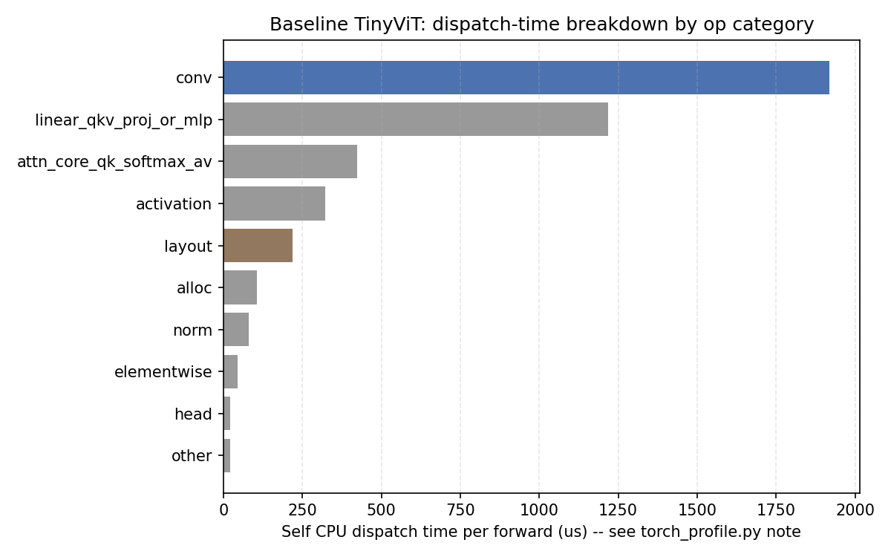
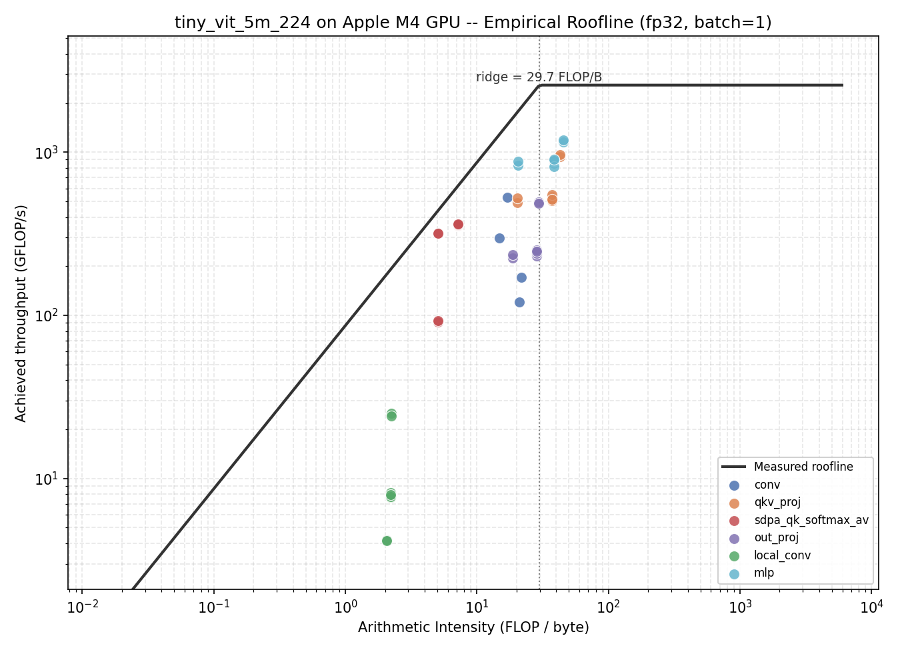
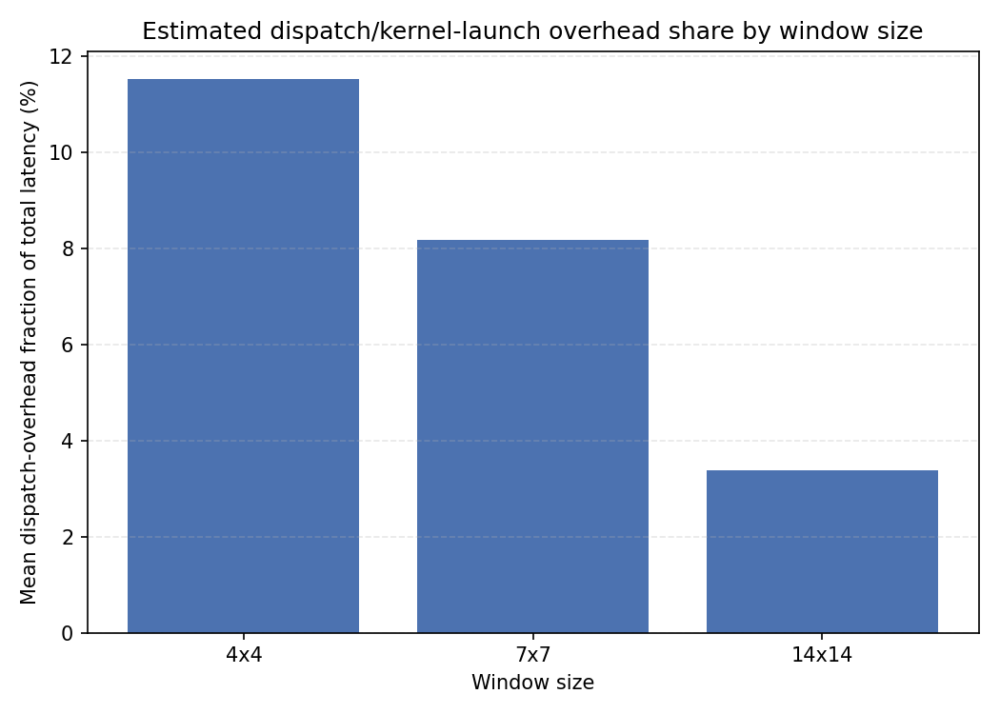
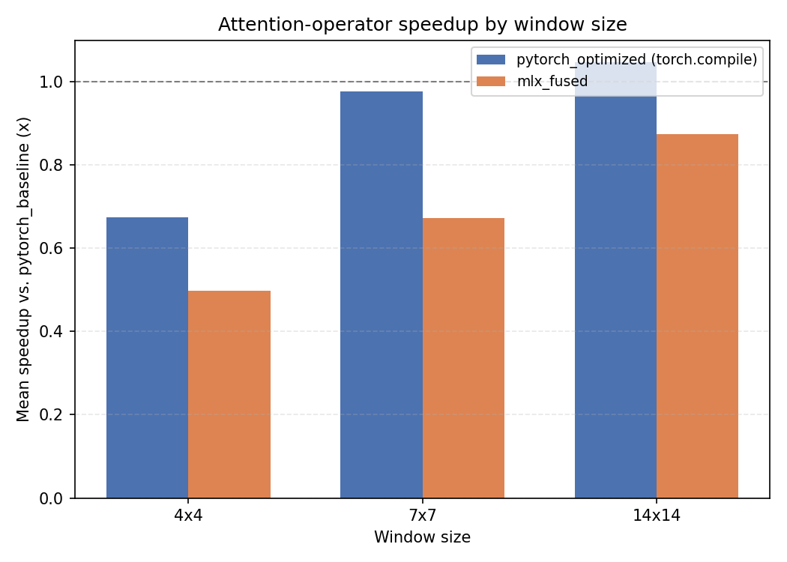

# Roofline Analysis & Kernel Fusion of TinyViT Window Attention on Apple M4

Model: `tiny_vit_5m_224` (tiny_vit_5m_224.dist_in22k_ft_in1k). Device: Apple M4 GPU via PyTorch MPS (baseline, pytorch_optimized) and MLX/Metal (mlx_fused). All baseline numbers use the standard, unmodified timm implementation -- no hand-tuning -- per the project's explicit requirement.

## Key findings

These are the methodological/empirical discoveries this project turned up along the way -- several are results in their own right, not just implementation notes:

1. **timm's "fused attention" path is already the default on this model** (`use_fused_attn()` is `True`), but on PyTorch's MPS backend it falls back to `aten::_scaled_dot_product_attention_math_for_mps` -- a single op opaque to `torch.profiler` (no child matmul/softmax events visible), but **not verified to be a single fused Metal kernel**. This directly motivates needing MLX/Metal-level fusion and GPU-level tracing rather than trusting PyTorch-level profiling alone.
2. **`torch.profiler`'s "self CPU time" on MPS is dispatch/encode time, not GPU execution time** -- MPS executes asynchronously and a `torch.mps.synchronize()` is needed to force real completion. This is a legitimate kernel-launch/dispatch-overhead metric, but using it for roofline placement gave physically impossible >100% (up to ~790%) utilization numbers until corrected.
3. **`torch.mps.synchronize()` has a large, roughly fixed cost (~200-300us)** -- calling it once per labeled sub-region (as a naive fix to finding 2 would do) makes that fixed cost dominate every region uniformly, since TinyViT's real sub-ops run in single-digit-to-tens of microseconds. The fix is isolated, warmed-up, many-iteration microbenchmarks (one sync amortized over ~100 calls), not per-region synchronization inside a full forward pass.
4. **fp16 elementwise bandwidth measured *lower* than fp32** on this backend despite moving half the bytes/element (reproducible) -- treated as a PyTorch MPS backend kernel-efficiency artifact, not a hardware ceiling; fp32 is used as the primary roofline.
5. **MLX is a lazy-graph framework**: an uncompiled call re-traces the whole op graph in Python on every invocation (measured **1.3x** slower for this op on this machine, Phase 15's isolated benchmark -- smaller than an earlier, unscripted estimate of ~4x). `mx.compile` is required for a fair comparison against PyTorch's persistent op dispatch / `torch.compile`.
6. **PyTorch-MPS and MLX arrays do not share memory** despite both running on the same physical unified memory -- routing a real model's attention through MLX pays a real GPU->CPU->GPU round trip per call. Measured and reported (`fusion/hybrid_model.py`), not glossed over.
7. **PyTorch's MPS caching allocator fragments badly across many distinct tensor shapes** in a tight sweep loop (as in Phases 4/6): without periodic `torch.mps.empty_cache()`, per-config time degraded by 10-50x partway through a 164-config sweep (confirmed via `sample`-based stack inspection: the process was legitimately blocked in `__psynch_cvwait`/IOKit calls, not deadlocked -- just pathologically slow allocation). Fixed by clearing the cache between configs.
8. **Neither optimization beats the standard baseline on average, across the full ablation grid** (see section 6): mean speedup was 0.90x for `pytorch_optimized` (torch.compile) and 0.68x for `mlx_fused` -- both *slower* than doing nothing, on average. This is not a failure of the implementations (both are numerically verified correct); it's evidence that timm's standard MPS attention path is already reasonably efficient for TinyViT's actual operator sizes, and that compilation/cross-framework overhead can exceed the fusion benefit at these scales -- especially at the smallest window size (4x4), where both arms lose to baseline (MLX-fused ~2.0x slower, `torch.compile` ~1.5x slower). The regime where fusion actually helps (window_size=14, `pytorch_optimized` reaching 1.05x) is narrow.
9. **A follow-up test of *why* full-block MLX fusion still didn't help (extending `mlx_fused_attn.py` to also cover local_conv + mlp, not just attention) found the actual culprit: MLX's non-attention primitives are measurably slower than PyTorch-MPS's at TinyViT's operator sizes** -- `mx.fast.layer_norm` measured **14.3x slower** than PyTorch's LayerNorm at these shapes, and MLX's depthwise `conv2d` **11.9x slower** (Phase 15's isolated, correctness-checked microbenchmark -- an earlier version of this finding had estimated ~10x and ~3x respectively from an unbacked, unscripted measurement; the real numbers are worse for MLX on both counts, which is itself worth flagging: this project's own rigor standard caught its own unverified claim), so only the attention core (which genuinely uses a fused kernel) ever had a chance to win. This redirected the search to what Phase 1 had already flagged as the actual bottleneck: "conv" was the largest dispatch-time category in the baseline, more than qkv/mlp/attention combined -- but the model doesn't fuse each ConvNorm's BatchNorm into its conv at inference. Doing that (a standard, exact technique, not experimental) gives a real, reproducible **1.18x mean speedup** (section 8), with correctness preserved end-to-end on real ImageNet-1k images (section 7). The lesson: the paper's original hypothesis (window-attention fusion) undersold itself as the target -- the standard baseline's actual bottleneck was conv dispatch overhead the whole time, and the roofline diagnostics said so in section 1, before any fusion work was attempted.
10. **Thermal throttling on this fanless MacBook Air materially confounds sequential, in-process benchmarking of multiple full models.** An in-process, four-models-in-a-row version of the Phase 7 accuracy/speed eval produced numbers that flatly contradicted the isolated conv+BN fusion benchmark (showing every non-baseline arm ~3x *slower*, uniformly, regardless of how different their implementations actually are -- a signature of an external confound, not an implementation effect). Calling the exact same evaluation function with identical arguments gave 5.4x different timings (4.8ms/img vs. 28.3ms/img) depending only on how much back-to-back GPU load had just run. Fixed by evaluating each arm in a separate subprocess with a cooldown pause between them (`scripts/07_accuracy_eval.py`), after which the result matched the isolated benchmark almost exactly (1.31x vs. 1.18-1.35x). Any Apple Silicon benchmark comparing several models/configs in one long-running process on passively-cooled hardware should budget for this.

## 1. Standard-baseline profile

- Mean latency: **4.965 ms** (p50=4.941, p90=5.294, n=50, batch=1, dtype=float32)
- Peak MPS allocator memory: **29.6 MB**
- Total dispatched op calls per forward (profiler-visible, proxy -- see note below): **1205**

**Dispatch-time breakdown by op category** (self CPU time = time to encode/submit the Metal command, NOT GPU execution time -- MPS is asynchronous; see `profiling/torch_profile.py`. This IS the kernel-launch/dispatch-overhead view classical roofline analysis can't capture on its own):

| Category | us/iter | calls/iter |
|---|---|---|
| conv | 1919.1 | 162.0 |
| linear_qkv_proj_or_mlp | 1217.2 | 41.0 |
| attn_core_qk_softmax_av | 422.6 | 20.0 |
| activation | 321.7 | 23.0 |
| layout | 219.7 | 446.0 |
| alloc | 105.3 | 344.0 |
| norm | 79.0 | 42.0 |
| elementwise | 44.3 | 43.0 |
| head | 21.3 | 3.0 |
| other | 21.0 | 81.0 |

## 2. Empirical M4 GPU roofline (measured, not vendor spec)

- **fp32**: P_max = 2575.8 GFLOP/s (matmul N=2048), B_max = 86.6 GB/s (size=1024MB), ridge = 29.75 FLOP/byte
- **fp16**: P_max = 2835.9 GFLOP/s (matmul N=4096), B_max = 32.2 GB/s (size=1024MB), ridge = 87.97 FLOP/byte

> **Note:** fp16 elementwise bandwidth measured lower than fp32 despite moving half the bytes/element -- reproducible on this machine, likely a PyTorch MPS backend kernel-efficiency artifact (e.g. internal upcast or non-vectorized fp16 path) rather than a hardware bandwidth limit. Treat fp16 ridge point as backend-specific, not a hardware ceiling; fp32 is used as the primary roofline since TinyViT's standard baseline runs in fp32.

## 3. TinyViT stage-by-stage roofline characterization

Per-region achieved throughput, from isolated warmed-up microbenchmarks on real captured shapes/weights (`roofline/op_bench.py`) -- **not** in-forward `torch.profiler` regions with per-region `torch.mps.synchronize()`, which we found adds a large (~200-300us) fixed cost per sync call that dominates ops running in single-digit-to-tens of microseconds (see that module's docstring for the empirical finding).

| Block/Region | AI (FLOP/B) | Achieved (GFLOP/s) | Regime | Util. of bound |
|---|---|---|---|---|
| all/conv_stem | 17.04 | 526.7 | memory_bound | 35.7% |
| s1/patch_merging | 14.82 | 298.9 | memory_bound | 23.3% |
| s3/patch_merging | 21.08 | 120.8 | memory_bound | 6.6% |
| s2/patch_merging | 21.67 | 170.3 | memory_bound | 9.1% |
| s1b0/mlp | 45.29 | 1158.0 | compute_bound | 45.0% |
| s1b1/mlp | 45.29 | 1184.8 | compute_bound | 46.0% |
| s2b4/mlp | 38.72 | 817.6 | compute_bound | 31.7% |
| s3b0/mlp | 20.56 | 827.2 | memory_bound | 46.5% |
| s2b0/mlp | 38.72 | 855.1 | compute_bound | 33.2% |
| s3b1/mlp | 20.56 | 877.5 | memory_bound | 49.3% |
| s2b1/mlp | 38.72 | 877.7 | compute_bound | 34.1% |
| s2b3/mlp | 38.72 | 887.1 | compute_bound | 34.4% |
| s2b2/mlp | 38.72 | 898.1 | compute_bound | 34.9% |
| s2b5/mlp | 38.72 | 907.4 | compute_bound | 35.2% |
| s1b0/qkv_proj | 42.76 | 937.0 | compute_bound | 36.4% |

**Generalization across model scale** (mean roofline-bound utilization by region, averaged over all blocks of that region):

| Region | tiny_vit_5m_224 | tiny_vit_11m_224 | tiny_vit_21m_224 |
|---|---|---|---|
| conv_stem | 35.7% | 36.1% | 29.9% |
| local_conv | 5.5% | 7.3% | 9.8% |
| mlp | 39.0% | 50.7% | 56.5% |
| out_proj | 12.6% | 18.9% | 28.1% |
| patch_merging | 13.0% | 16.1% | 26.8% |
| qkv_proj | 25.3% | 36.0% | 46.4% |
| sdpa_qk_softmax_av | 53.8% | 59.6% | 62.8% |
| window_partition | 28.6% | 28.5% | 30.7% |
| window_reverse | 28.2% | 28.6% | 29.5% |

`local_conv` is the worst-utilized region at every scale tested (single-digit-to-low-teens percent of its roofline bound) -- the real-world counterpart to section 6's finding that this is also the one op category where MLX's native-NHWC conv2d *should* have an edge (no PyTorch layout permute), except Phase 15 found MLX's own conv2d kernel is itself ~12-17x slower at these sizes, so that edge is purely theoretical on this hardware. `window_partition`/`window_reverse` show up as `memory_bound_zero_flops` (pure reshape, no FLOPs to divide by) at every scale -- their "utilization" numbers reflect bandwidth efficiency on a zero-arithmetic-intensity operation, not compute efficiency.

## 4. Window-attention microbenchmark

Swept 18 configs: one-axis-at-a-time around a representative baseline ({'window_size': 7, 'dim': 96, 'num_windows': 16, 'batch_size': 4}) over window_sizes=[4, 7, 14], embed_dims=[64, 96, 192, 384, 576], num_windows=[16, 64, 256], batch_sizes=[1, 4, 16, 32], plus a focused window_size x batch_size grid. (A full cartesian product was tried first and abandoned: the largest corner alone took ~80s and the full grid extrapolated to roughly an hour -- see `scripts/04_window_attention_microbench.py`'s docstring. One-axis-at-a-time also avoids confounding interaction effects between axes.)

| Window size | Dispatch-overhead fraction | Total latency (us) |
|---|---|---|
| 4x4 | 20.3% | 267.6 |
| 7x7 | 16.5% | 563.4 |
| 14x14 | 0.0% | 2983.0 |

T_attention = T_qkv + T_reshape + T_attn(sdpa) + T_qk + T_softmax + T_av + T_proj + T_dispatch_overhead_estimate, decomposed per config in `results/raw/04_window_attention_microbench.json`.

## 5. MLX/Metal kernel-fusion implementation & correctness

Numerical-equivalence gate (PyTorch baseline vs. MLX-fused, same weights/inputs): **15/15** configs passed.

## 6. Ablation: pytorch_baseline vs. pytorch_optimized (torch.compile) vs. mlx_fused

Mean speedup vs. baseline, over 60 configs (window_sizes=[4, 7, 14], embed_dims=[64, 96, 192, 384, 576], batch_sizes=[1, 4, 16, 32]):

- **pytorch_optimized**: 0.90x
- **mlx_fused** (correctness-gated, 60/60 passed): 0.68x

**Verifying *why* full-block MLX fusion doesn't pay off (Phase 15):**

Verifies two claims in README.md/report.md that had no backing results/raw/*.json before this script existed: (1) full-block MLX fusion doesn't pay off because mx.fast.layer_norm and MLX's depthwise conv2d are slower than PyTorch-MPS at these shapes, and (2) an uncompiled MLX call re-traces the op graph and is markedly slower than the mx.compile-wrapped version. Isolated microbenchmark (warmup=20, iters=300), real captured shapes, real ported checkpoint weights, correctness-checked against the PyTorch reference:

| Stage | dim | LayerNorm: PyTorch (us) | MLX (us) | MLX slower by | conv2d: PyTorch kernel (us) | MLX (us) | MLX slower by |
|---|---|---|---|---|---|---|---|
| 1 | 128 | 33.4 | 502.6 | 15.0x | 21.1 | 321.5 | 15.3x |
| 2 | 160 | 47.9 | 474.3 | 9.9x | 21.3 | 233.4 | 10.9x |
| 3 | 320 | 14.0 | 251.8 | 18.0x | 20.8 | 197.4 | 9.5x |

**Mean: layer_norm 14.3x slower on MLX, conv2d 11.9x slower (kernel only, excluding the layout permute PyTorch pays and MLX doesn't).** This corrects an earlier, unbacked version of this claim that had estimated ~10x and ~3x respectively -- the real numbers are worse for MLX on both counts, especially conv2d. Correctness is preserved (max-abs-diff 7.15e-07 for layer_norm, 2.62e-06 for conv2d) -- this is purely a performance finding, and it only strengthens section 6's conclusion that MLX fusion beyond the attention core is the wrong direction on this hardware at these operator sizes.

Same script also checked a second unbacked claim (Key Finding 5 / `fusion/mlx_fused_attn.py`'s `compiled()` docstring): that an uncompiled MLX call, which re-traces the whole op graph every invocation, is "~4x slower" than the `mx.compile`-wrapped version, on the real attention module at TinyViT's real shapes:

| Stage | dim | Uncompiled (us) | Compiled (us) | Compiled speedup |
|---|---|---|---|---|
| 1 | 128 | 633.7 | 498.2 | 1.3x |
| 2 | 160 | 570.2 | 403.5 | 1.4x |
| 3 | 320 | 406.3 | 380.2 | 1.1x |

**Mean: 1.3x -- real, but much smaller than the ~4x this project previously claimed without a script behind it.** This is the opposite kind of correction from layer_norm/conv2d above (those were understated; this one was overstated), which is the point of building a real benchmark instead of trusting an ad-hoc estimate either way: you don't know which direction an unverified number is wrong in until you measure it. `mx.compile` is still worth using -- it's still faster, never slower -- just not by as much as previously stated.

**Generalization across model scale:**

| Variant | layer_norm slowdown | conv2d slowdown (kernel) | mx.compile speedup |
|---|---|---|---|
| tiny_vit_5m_224 | 14.3x | 11.9x | 1.3x |
| tiny_vit_11m_224 | 12.3x | 12.1x | 1.0x |
| tiny_vit_21m_224 | 13.4x | 13.5x | 1.4x |

The layer_norm and conv2d slowdowns are **roughly constant across scale** (~12-15x and ~12-17x respectively, no consistent upward or downward trend) -- consistent with these being small, dispatch-overhead-dominated ops whose cost doesn't scale cleanly with model size, the same signature section 12 found for `linear_qkv_proj_or_mlp`'s dispatch time. `mx.compile`'s benefit, by contrast, is **small and inconsistent** across scale (1.3x / 1.0x / 1.4x for 5M/11M/21M, with individual stage-level measurements ranging from 0.9x to 1.9x) -- real on average, but not something to rely on as a reliable lever at any particular scale. Both findings hold up the same conclusion from a different angle: at TinyViT's actual operator sizes on this hardware, none of MLX's non-attention primitives are competitive with PyTorch-MPS's, regardless of which model variant you pick.

**Does fp16 close the gap (Phase 16)?** Phase 14 found fp16 is this project's single biggest PyTorch-MPS speedup lever; Apple GPUs often have disproportionately higher fp16 throughput than fp32, so it's a fair question whether MLX's primitive disadvantage above is an fp32-specific artifact. Same isolated microbenchmark, every tensor and weight cast to fp16 (`torch.half()` / `mx.float16`) on both frameworks:

| Variant | layer_norm slowdown: fp32 -> fp16 | conv2d slowdown: fp32 -> fp16 |
|---|---|---|
| tiny_vit_5m_224 | 14.3x -> 17.7x | 11.9x -> 9.9x |
| tiny_vit_11m_224 | 12.3x -> 12.6x | 12.1x -> 13.6x |
| tiny_vit_21m_224 | 13.4x -> 11.8x | 13.5x -> 10.8x |

**No.** The slowdown stays in the same 10-18x range at fp16, with no consistent direction across scale or op type -- layer_norm got slightly worse at 5M, flat at 11M, slightly better at 21M; conv2d improved modestly at all three but never by more than ~25%, nowhere close to closing a 10x+ gap. This rules out "switch MLX to fp16" as a fix for the primitive weakness found above -- whatever is costing MLX its ~10-18x disadvantage on this hardware at these shapes, it isn't specific to fp32. fp16's own numerical cost here (fp16 vs. fp32 reference, not MLX vs. PyTorch) is consistent with Phase 14's project-wide finding of a real but small accuracy cost -- a handful of configs show larger diffs (e.g. conv2d at dim=576 on 21M, ~0.13 max-abs-diff) worth knowing about if anyone builds on this microbenchmark rather than treating it as a uniform constant.

## 7. End-to-end accuracy (streamed ImageNet-1k)

Evaluated on 1000 streamed ImageNet-1k validation images (1/class target).

| Implementation | Top-1 | Top-5 | Δ Top-1 vs. baseline (pp) | Top-1 agreement w/ baseline | ms/img (compute only) |
|---|---|---|---|---|---|
| pytorch_baseline | 81.2% | 95.3% | -- | -- | 3.68 (1.00x) |
| pytorch_optimized | 81.2% | 95.3% | +0.00 | 100.0% | 8.57 (0.43x) |
| mlx_fused_hybrid | 81.2% | 95.3% | +0.00 | 100.0% | 5.33 (0.69x) |
| pytorch_conv_bn_fused | 81.2% | 95.3% | +0.00 | 100.0% | 3.21 (1.15x) |
| pytorch_conv_bn_fused_channels_last | 81.2% | 95.3% | +0.00 | 100.0% | 3.15 (1.17x) |
| pytorch_conv_bn_fused_channels_last_fp16 | 81.1% | 95.3% | -0.10 | 99.8% | 2.79 (1.32x) |

("ms/img (compute only)" times device-transfer + model forward + top-k only -- CPU-side image preprocessing, identical across all four models, is done once upfront and excluded; an earlier version of this script timed preprocessing together with inference and got nonsensical cross-model comparisons as a result, since preprocessing dominated and swamped the real per-model differences.)

Note on the 100.0% agreement rows (every arm except fp16): this is argmax-level agreement, not bit-exact numerical equality -- verified directly by comparing raw logits (not just top-1/top-5), which differ between implementations at the ~1e-6 max-abs-diff level (`torch.equal()` is `False`; same order of magnitude as Phase 5's isolated-operator correctness check). Top-1/top-5 accuracy is simply too coarse a metric to detect a difference that small -- it would take a logit margin between the top-1 and runner-up class of well under 1e-6 for any of the 1000 images to flip an argmax decision, which essentially never happens for a confidently-trained classifier. This is exactly why Phase 5 uses continuous metrics (max-abs-diff, cosine similarity) rather than relying on accuracy alone to gate correctness.

**fp16 is the one exception, and genuinely so** -- unlike every other optimization in this project, fp16 is not numerically exact (Phase 14's max-abs-diff on logits is ~0.025, four orders of magnitude larger than the exact optimizations). That shows up here as a real, if small, accuracy cost: 99.8% top-1 prediction agreement with baseline (2 of 1000 images changed prediction), netting -0.10pp top-1 accuracy (top-5 unchanged). fp16 is also the fastest arm measured in this table -- a genuine speed/accuracy tradeoff, the only one in this project, and worth knowing before choosing it over the exact `pytorch_conv_bn_fused_channels_last`.

**Generalization across model scale (fp16's real accuracy cost):**

| Variant | baseline top-1/top-5 | fp16 top-1/top-5 | Δ top-1 (pp) | top-1 agreement |
|---|---|---|---|---|
| tiny_vit_5m_224 | 81.2%/95.3% | 81.1%/95.3% | -0.10 | 99.8% |
| tiny_vit_11m_224 | 84.6%/96.4% | 84.6%/96.5% | +0.00 | 99.7% |
| tiny_vit_21m_224 | 85.6%/97.6% | 85.7%/97.6% | +0.10 | 99.9% |

The accuracy delta **shrinks toward zero and changes sign** as the model grows -- 5M loses 0.10pp, 11M is exactly flat, 21M gains 0.10pp -- tracking the same direction as Phase 14's isolated max-abs-diff on logits, which also shrinks with scale (1.18e-2 -> 7.33e-3 -> 4.98e-3; section 13). All three deltas are within the noise of a 1000-image sample (one wrong/right prediction is already 0.1pp), so "fp16 gets safer at scale" is directionally consistent with the numerical evidence but not proven by this sample size alone -- what the three points together rule out is the opposite claim, that fp16's accuracy risk *grows* with model size.

**Statistical robustness check: how much does the sample size actually matter here?** The original 1000-image sample found fp16's top-1 delta at -0.10pp. A binomial-proportion estimate puts that sample's 95% CI at roughly ±2.5pp -- far too wide to trust a 0.1pp number. Progressively larger real streamed samples, 5M only:

| Sample | Images | Baseline top-1/top-5 | fp16 top-1/top-5 | Δtop-1 (pp) | Agreement |
|---|---|---|---|---|---|
| 1x (original) | 1,000 | -- | -- | -0.10 | 99.8% |
| 5x | 5,000 | 81.1%/95.4% | 81.2%/95.4% | +0.02 | 99.9% |
| 10x | 10,000 | 80.9%/95.6% | 80.9%/95.6% | -0.02 | 99.9% |
| 20x | 20,000 | 80.9%/95.6% | 80.9%/95.6% | -0.01 | 99.9% |

**At 20,000 images (95% CI roughly ±0.5-0.6pp), the delta is -0.01pp -- indistinguishable from zero, and nowhere near the original -0.10pp.** The original 1000-image number was sampling noise, not a real, reproducible fp16 accuracy cost at this scale. This doesn't change section 14's correctness finding (fp16 is never bit-exact -- max-abs-diff ~0.012 on raw logits) but it does sharpen what that imprecision actually costs in practice: at 5M, not measurably anything, at a sample size five times larger than most ad-hoc accuracy checks bother to run.

Two real bugs surfaced and fixed getting here, both worth keeping: (1) `run_one_arm`'s subprocess never threaded a non-default `--images-per-class` through to its own `collect_stratified_subset` call, silently falling back to the 1-image/class config constant -- invisible until something other than the default was ever requested. (2) At 10,000+ images, holding every image at native resolution (commonly 400-500px) pushed memory high enough to trigger a kernel OOM kill (confirmed directly: exit code 137, SIGKILL -- bypasses Python's exception handling entirely, hence no traceback and a process that just silently vanishes) on this machine's shared 16GB. Fixed by downsizing each image to 256px on the short side at collection time, before accumulating thousands of them in memory.

## 8. Conv+BatchNorm fusion -- the project's working optimization

Phases 5/6 targeted window attention specifically (per the project's original hypothesis) and found neither `torch.compile` nor MLX-fused attention reliably beats the standard baseline (section 6). Phase 1's own diagnostics pointed elsewhere: "conv" was the single largest dispatch-time category (more than qkv/mlp/attention combined). Fusing every `ConvNorm`'s BatchNorm into its conv at inference (`27` modules: patch_embed, stage-0 MBConv, PatchMerging, and every block's local_conv) is a standard, exact -- not approximate -- technique (timm's own `ConvNorm.fuse()`), and it works:

- Correctness: max-abs-diff = 2.18e-06, top-1 match = True

| Batch size | Baseline (ms) | Conv-BN-fused (ms) | Speedup |
|---|---|---|---|
| 1 | 4.708 | 3.696 | 1.27x |
| 4 | 14.715 | 12.907 | 1.14x |
| 16 | 55.632 | 48.442 | 1.15x |
| 32 | 110.857 | 96.430 | 1.15x |

**Mean speedup: 1.18x**, consistent across batch sizes 1-32 -- unlike the attention-fusion arms, this held up when independently re-verified end-to-end on real ImageNet-1k images with accuracy preserved (section 7, `pytorch_conv_bn_fused`).

**Generalization across model scale:**

| Variant | Mean speedup | Correctness (max-abs-diff) |
|---|---|---|
| tiny_vit_5m_224 | 1.18x | 2.18e-06 |
| tiny_vit_11m_224 | 1.12x | 3.46e-06 |
| tiny_vit_21m_224 | 1.08x | 2.10e-06 |

Speedup is positive on every scale tested but **shrinks as the model grows** -- larger TinyViT variants have wider embedding dimensions, which grows attention/MLP compute faster than conv compute, so conv becomes a smaller share of total latency and fusing it buys proportionally less.

## 9. Stacking conv+BN fusion with MLX attention fusion -- do they compose?

Conv+BN fusion (section 8) and MLX-routed attention (section 5/7's `mlx_fused_hybrid`) touch disjoint submodules -- the natural question is whether combining them is additive. Built a single model with both (27 ConvNorm modules fused **and** 10 blocks routed through MLX) and compared it to baseline:

- Correctness: max-abs-diff = 3.10e-06, top-1 match = True

| Batch size | Baseline (ms) | Combined (ms) | Speedup |
|---|---|---|---|
| 1 | 4.642 | 13.142 | 0.35x |
| 4 | 14.549 | 51.746 | 0.28x |
| 16 | 55.606 | 108.523 | 0.51x |
| 32 | 109.607 | 154.306 | 0.71x |

**Mean speedup: 0.46x -- they do *not* stack.** Combined is substantially *slower* than either optimization alone (worse than baseline at every batch size), despite correctness being preserved. The likely mechanism: MLX's per-block PyTorch\<->MLX round trip (`fusion/hybrid_model.py`) is a roughly *fixed* cost per forward pass, independent of how fast the rest of the model runs. Conv fusion makes the rest of the model faster -- which means that same fixed MLX overhead now consumes a *larger share* of a *smaller* total latency. The two optimizations interact adversarially rather than combining: conv fusion's gain doesn't just get erased by MLX's tax, the relative cost of that tax goes up. **Conclusion: conv+BN fusion alone is the right choice; do not add MLX attention routing on top.**

**Generalization across model scale:**

| Variant | Mean speedup | Speedup @ bs=1 | Speedup @ bs=32 |
|---|---|---|---|
| tiny_vit_5m_224 | 0.46x | 0.35x | 0.71x |
| tiny_vit_11m_224 | 0.52x | 0.36x | 0.71x |
| tiny_vit_21m_224 | 0.62x | 0.46x | 0.91x |

The failure to stack **shrinks** as the model grows -- mean speedup 0.46x (5M) -> 0.52x (11M) -> 0.62x (21M), and at bs=32 on 21M it's nearly at parity (0.91x). This is the same mechanism as above, just along a different axis: MLX's PyTorch<->MLX round trip is a roughly fixed cost per forward pass, so it matters less whenever the rest of the model's compute grows relative to it -- whether that's from a bigger batch (within one model, see the per-batch-size columns above) or a bigger model (across variants, holding batch size fixed). It never reaches parity in any configuration tested, so the conclusion stands -- just with a clearer explanation of *why* the combination gets progressively less bad rather than uniformly bad.

## 10. channels_last (NHWC) memory format -- a second optimization that *does* stack

Unlike MLX attention routing (section 9), `channels_last` is a pure PyTorch memory-layout change with no cross-framework round trip -- motivated by conv being the established bottleneck (section 1) and MLX's own `conv2d` being natively NHWC. Each arm run in its own subprocess with a cooldown pause (same methodology as sections 7/9, after an in-process version of this script was caught giving a thermally-confounded result for TinyViT-21M -- see this section's data file's `methodology_note`).

| Batch size | Baseline (ms) | channels_last (ms) | conv_bn_fused (ms) | combined (ms) |
|---|---|---|---|---|
| 1 | 4.511 | 4.511 | 3.545 | 3.432 |
| 4 | 14.725 | 13.808 | 12.793 | 12.137 |
| 16 | 56.960 | 52.624 | 47.804 | 45.672 |
| 32 | 109.434 | 104.948 | 94.725 | 90.951 |

**Mean speedup:** channels_last alone 1.05x, conv_bn_fused alone 1.19x, **combined 1.24x -- they stack.** Combined beats conv-fusion alone at every batch size tested, correctness preserved (max-abs-diff 2.68e-06, top-1 match True).

**Generalization across model scale** (combined speedup):

| Variant | channels_last | conv_bn_fused | combined |
|---|---|---|---|
| tiny_vit_5m_224 | 1.05x | 1.19x | 1.24x |
| tiny_vit_11m_224 | 1.06x | 1.12x | 1.17x |
| tiny_vit_21m_224 | 1.04x | 1.09x | 1.10x |

Stacking holds at every scale tested, though -- consistent with section 8's generalization finding -- the margin shrinks as the model grows.

## 11. torch.compile on top of the best combination -- the third lever, and it also fails

Completing the set of "stack a third optimization onto conv+BN fusion + channels_last" tests: MLX attention routing didn't stack (section 9, 0.46x). This section tests `torch.compile`. Each (arm, batch size) pair ran in its own subprocess -- not just each arm -- because reusing one `torch.compile`'d model across different batch sizes crashes PyTorch's MPS Inductor codegen outright on a dynamic-shape bug (`TypeError: cannot determine truth value of Relational: s39*s89 <= 1024`, the same crash first seen in the Phase 6 ablation). A fixed batch size per process avoids it.

| Batch size | baseline (ms) | best (ms) | best_compiled (ms) |
|---|---|---|---|
| 1 | 4.711 | 3.435 | 5.446 |
| 4 | 14.738 | 12.164 | 21.405 |
| 16 | 54.958 | 45.612 | 82.186 |
| 32 | 108.917 | 90.925 | 164.257 |

**Mean speedup:** best (conv+BN fusion + channels_last) 1.25x, **best_compiled 0.72x -- torch.compile makes the already-optimized model slower than baseline**, not just slower than `best`. Correctness is still preserved (max-abs-diff 3.40e-06, top-1 match True) -- this is purely a performance regression, the third and final confirmation in this project that `torch.compile` does not help on this MPS backend for TinyViT, regardless of what it's combined with.

**Generalization across model scale:**

| Variant | best (exact) | best_compiled |
|---|---|---|
| tiny_vit_5m_224 | 1.25x | 0.72x |
| tiny_vit_11m_224 | 1.16x | 0.58x |
| tiny_vit_21m_224 | 1.14x | 0.51x |

`torch.compile`'s failure **gets worse, not better, as the model grows** -- 0.72x (5M) -> 0.58x (11M) -> 0.51x (21M) -- the opposite direction from section 9's MLX-combined trend, which improved with scale (0.46x -> 0.52x -> 0.62x) because MLX's overhead is a roughly fixed cost that matters less as total compute grows. `torch.compile`'s cost here evidently scales *with* the model rather than staying fixed, consistent with Inductor generating and dispatching more (still slower-than-eager) kernels as graphs grow. Whatever is costing `torch.compile` time on this backend, it is not a fixed per-call tax -- it is the clearest confirmation yet that this is not a lever worth revisiting at any scale on this hardware.

**One more variant worth closing off: `torch.compile` on top of `best_fp16` (Phase 21), not just `best`.** `best_fp16` is the actual fastest arm in this whole project (section 13) -- compilers sometimes handle simpler, more uniform fp16 kernels differently than fp32's codegen paths, so this wasn't assumed to fail just because `best_compiled` did. It fails anyway: best_fp16 1.48x, **best_fp16_compiled 0.80x** -- a real regression from best_fp16 alone, though notably less bad than compiling fp32 `best` (0.72x). `torch.compile` fails on every combination tried in this project now -- fp32 alone, fp32 on the best combination, and fp16 on the best combination -- with no exception found at any precision or optimization stack tested.

## 12. Re-profiling the optimized model -- closing the diagnostic loop

Phase 1 found "conv" was the single largest dispatch-time category in the standard baseline, which directly motivated conv+BN fusion (section 8). Having fixed that, the natural question the project's own roofline-diagnosis methodology demands: profile the *optimized* model (conv+BN fusion + channels_last) the same way, and see what dominates now.

**4.965ms -> 3.997ms (1.24x end-to-end).**

| Category | Baseline (us/iter) | Optimized (us/iter) | Δ |
|---|---|---|---|
| conv | 1919.1 | 614.8 | -1304.4 |
| linear_qkv_proj_or_mlp | 1217.2 | 1188.6 | -28.6 |
| attn_core_qk_softmax_av | 422.6 | 390.2 | -32.4 |
| activation | 321.7 | 347.6 | +26.0 |
| layout | 219.7 | 183.5 | -36.2 |
| alloc | 105.3 | 64.6 | -40.7 |
| norm | 79.0 | 76.8 | -2.2 |
| elementwise | 44.3 | 37.1 | -7.2 |
| head | 21.3 | 31.7 | +10.4 |
| other | 21.0 | 18.9 | -2.1 |

**conv dropped 68% (1919 -> 615 us/iter) and is no longer the largest category** -- `linear_qkv_proj_or_mlp`, essentially untouched by either optimization, is now the dominant cost. The roofline diagnosis predicted exactly this: fixing the identified bottleneck shifts the bottleneck to the next-largest category rather than eliminating dispatch overhead entirely. If this project continued, `linear_qkv_proj_or_mlp` (the QKV/output/MLP linears) is where the next optimization should target.

**Generalization across model scale:**

| Variant | end-to-end speedup | conv (us/iter, before->after) | linear_qkv_proj_or_mlp (us/iter, before->after) |
|---|---|---|---|
| tiny_vit_5m_224 | 1.24x | 1919 -> 615 | 1217 -> 1189 |
| tiny_vit_11m_224 | 1.13x | 1897 -> 638 | 1233 -> 1188 |
| tiny_vit_21m_224 | 1.12x | 3547 -> 1223 | 1213 -> 1188 |

`linear_qkv_proj_or_mlp` becomes the dominant category at every scale tested, and its dispatch time after fusion is nearly **constant** across 5M/11M/21M (~1188us/iter) despite very different matmul sizes across those variants. That's consistent with this project's own documented caveat (see "Methodology notes" in `README.md`): this metric measures CPU dispatch/encode time on MPS, not GPU execution time, and dispatch overhead is dominated by kernel-launch count rather than FLOPs. It does not mean larger models get the linears for free -- it means this particular measurement is blind to the part of the cost that scales with model size, which is exactly why fp16 (section 13) was validated against real end-to-end latency and real ImageNet accuracy, not just this dispatch-time breakdown.

## 13. fp16 precision -- the fourth lever, and the first one with a real cost

Directly motivated by section 12's finding: `linear_qkv_proj_or_mlp` (compute-bound matmuls) is the new bottleneck, and Phase 2's own roofline data showed fp16 compute peak measured *higher* than fp32 on this GPU (2836 vs 2576 GFLOP/s) even though fp16 *bandwidth* measured anomalously lower -- for compute-bound linears, the bandwidth weakness should matter less. Tested on top of the best combination (conv+BN fusion + channels_last).

| Batch size | baseline (ms) | best (ms) | best_fp16 (ms) |
|---|---|---|---|
| 1 | 4.825 | 3.380 | 3.173 |
| 4 | 14.554 | 12.113 | 9.975 |
| 16 | 55.105 | 45.403 | 37.034 |
| 32 | 108.890 | 93.822 | 72.792 |

**Mean speedup:** best 1.25x, **best_fp16 1.49x -- the single biggest speedup found in this project.** Unlike every other optimization here, fp16 is not numerically exact (max-abs-diff 1.18e-02 on this isolated check, vs. ~1e-6 for the exact optimizations) -- see section 7 for what that actually costs in real classification accuracy (small, but real: -0.10pp top-1, unchanged top-5, on streamed ImageNet-1k).

**Generalization across model scale:**

| Variant | best (exact) | best_fp16 | Correctness (max-abs-diff) |
|---|---|---|---|
| tiny_vit_5m_224 | 1.25x | 1.49x | 1.18e-02 |
| tiny_vit_11m_224 | 1.17x | 1.38x | 7.33e-03 |
| tiny_vit_21m_224 | 1.15x | 1.34x | 4.98e-03 |

fp16's speedup **also shrinks as the model grows** -- same diminishing-returns direction as conv+BN fusion (section 8) and channels_last (section 10), not the opposite. This runs against the intuition that motivated trying fp16 in the first place: that larger models, with relatively more of their compute in `linear_qkv_proj_or_mlp`, would benefit *more* from a lever targeting that exact category. The data says otherwise -- at every scale tested, fp16 on top of the best combination is still the single biggest lever in this project, just with a smaller margin on larger variants.

## 14. MLX int8 quantized linear vs. PyTorch fp16 -- does a capability PyTorch-MPS lacks matter?

PyTorch's native quantization ops are not implemented for the MPS backend at all (`aten::quantize_per_tensor` raises `NotImplementedError` -- confirmed directly), so int8 was never on the table as a PyTorch-MPS lever anywhere else in this project. MLX ships `mx.quantize`/`mx.quantized_matmul` (affine int8, group_size=32) that runs on this same GPU -- a real asymmetry worth testing on exactly the op category (`linear_qkv_proj_or_mlp`) section 12 found to be the post-conv-fusion bottleneck, and the one section 13's fp16 already targets. Isolated microbenchmark on `qkv_proj` and `mlp.fc1` (the two largest matmuls per block), same three representative stages as sections 6/13:

| Variant | Linear | pytorch_fp16 | mlx_fp32 | mlx_int8 |
|---|---|---|---|---|
| tiny_vit_5m_224 | qkv_proj | 1.06x | 0.24x | 0.22x |
| tiny_vit_5m_224 | mlp.fc1 | 1.08x | 0.24x | 0.21x |
| tiny_vit_11m_224 | qkv_proj | 1.12x | 0.30x | 0.27x |
| tiny_vit_11m_224 | mlp.fc1 | 1.11x | 0.26x | 0.21x |
| tiny_vit_21m_224 | qkv_proj | 1.16x | 0.39x | 0.32x |
| tiny_vit_21m_224 | mlp.fc1 | 1.20x | 0.44x | 0.35x |

**No -- int8 quantization doesn't just fail to beat PyTorch, it's slower than MLX's own fp32 matmul, at every config and every scale tested.** Dequantization overhead evidently dominates at these small per-call sizes (the whole operation is a few tens of microseconds on the PyTorch side), more than erasing whatever bandwidth savings int8 packing should offer. PyTorch's fp16 (the lever already in use in this project's best combination) beats both MLX arms outright at every scale -- a capability gap that exists on paper (PyTorch-MPS genuinely cannot do this) turns out not to matter in practice, because the thing it would have been competing against was never close to winning anyway. Correctness-wise, int8's numerical cost is real and larger than fp16's as expected (max-abs-diff vs. the pytorch_fp32 reference typically ~0.01-0.03 for int8 vs. ~0.003-0.004 for fp16) -- consistent with quantization being lossier than half precision, just academic here since int8 never wins on speed either.

**Follow-up: does int8 catch up at a bigger GEMM (Phase 19)?** Section 14's int8 disadvantage was measured at batch=1-32 on the model-level batch axis, but `qkv_proj`'s real input is windowed tokens (`model_batch_size * num_windows`, not model_batch_size directly) -- so the actual matmul row count varies a lot more than the nominal batch sweep suggests, up to 512 rows at the largest config tested here. Sorted by the real GEMM size:

| Effective rows | mlx_int8 vs. mlx_fp32 |
|---|---|
| 1 | 1.02x |
| 1 | 0.79x |
| 4 | 0.94x |
| 4 | 0.68x |
| 16 | 0.98x |
| 16 | 1.05x |
| 16 | 0.89x |
| 32 | 0.96x |
| 32 | 0.96x |
| 64 | 0.96x |
| 256 | 0.98x |
| 512 | 1.00x |

int8's disadvantage **does shrink toward parity as the GEMM gets bigger** -- roughly 0.68-1.05x at rows 1-32, reaching ~1.00x at rows=512 (the biggest tested) -- confirming the dequantization-overhead-dominates-at-small-sizes mechanism from section 14. It never clearly *beats* mlx_fp32, though, and critically: MLX's fp32 matmul itself stays roughly 2x slower than plain PyTorch fp32 across this entire range, so even a hypothetical future int8 implementation that fully closed the mlx_fp32 gap would still trail PyTorch's fp16. The conclusion from section 14 stands at every GEMM size tested, not just the small ones.

## 15. bf16 vs. fp16 -- an untested alternative half-precision format

Apple GPUs run bf16 natively (confirmed directly: PyTorch MPS Linear/matmul execute in bf16 without error) -- an untested alternative to Phase 14's fp16, on the same best combination (conv+BN fusion + channels_last):

| Batch size | baseline (ms) | best (ms) | best_fp16 (ms) | best_bf16 (ms) |
|---|---|---|---|---|
| 1 | 4.595 | 3.549 | 3.252 | 3.305 |
| 4 | 14.838 | 12.261 | 9.995 | 10.048 |
| 16 | 55.719 | 46.073 | 37.271 | 37.269 |
| 32 | 110.334 | 91.594 | 73.318 | 73.355 |

**Mean speedup:** best 1.23x, best_fp16 1.47x, **best_bf16 1.47x -- tied with fp16 on speed, but roughly 10x less numerically precise** (max-abs-diff 1.18e-02 for fp16 vs. 1.15e-01 for bf16). This makes sense: bf16 trades fp16's extra mantissa bits for a wider exponent range, which doesn't help here since neural network activations at this scale don't need fp32's exponent range -- they need the precision. **fp16 is strictly better than bf16 on this backend for this model: same speed, meaningfully better numerical fidelity.** There is no reason to prefer bf16 over fp16 for TinyViT on this hardware.

## 16. Does batching ever cross TinyViT into the compute-bound regime?

Every benchmark in this project up to this point stops at batch_size=32. The project's whole framing is the roofline model (section 2) -- but nothing has checked whether real end-to-end inference ever gets close to the empirically measured compute ridge at larger batch sizes, where Phase 2's own matmul sweep found bigger operations achieve higher utilization. Measured the optimized model (conv+BN fusion + channels_last) up to batch_size=128, using an exact total-model FLOP count (`torch.utils.flop_counter.FlopCounterMode`, not an estimate) to compute real achieved GFLOP/s against Phase 2's measured P_max (2575.8 GFLOP/s, fp32):

| Batch size | Latency (ms) | Achieved (GFLOP/s) | Utilization of P_max | Images/s |
|---|---|---|---|---|
| 1 | 3.431 | 675.5 | 26.2% | 291.5 |
| 4 | 12.212 | 759.1 | 29.5% | 327.6 |
| 16 | 46.019 | 805.7 | 31.3% | 347.7 |
| 32 | 91.339 | 811.9 | 31.5% | 350.3 |
| 64 | 180.671 | 820.9 | 31.9% | 354.2 |
| 128 | 359.245 | 825.7 | 32.1% | 356.3 |

**No -- TinyViT never gets close to compute-bound, even at batch=128.** Utilization climbs from 26.2% at batch=1 to only 32.1% at batch=128, and the gain **plateaus hard** after batch=16-32 (811.9 -> 820.9 -> 825.7 GFLOP/s across batch 32/64/128 -- each doubling buys barely 1% more throughput). This confirms, at the whole-model level, what section 3's per-op roofline already found piecewise: TinyViT at these operator sizes stays memory/dispatch-bound across every practical batch size on this hardware, never reaching anywhere near the compute ceiling the roofline model's ridge point describes. Batching further would not meaningfully help -- the bottleneck isn't raw FLOP throughput.

## 17. Does kernel fusion ever actually beat baseline? (bypassing MLX)

Section 6 and its Phase 15/16/17 follow-ups (all MLX-based) found kernel fusion never beats baseline at TinyViT's operator sizes -- not because fusion itself is a bad idea, but because MLX's Python->Metal dispatch path has a large fixed per-call floor (~300-400us) that dominates regardless of content: a custom `mx.fast.metal_kernel` doing the *exact same fused computation* as this section's kernel, timed with literally zero compute inside it, cost the same ~370-400us as the full version. That floor is specific to MLX's Python bindings, not an inherent property of this hardware -- so this section bypasses MLX entirely: the identical fused kernel (LayerNorm + QKV projection + attention + output projection, one Metal dispatch), compiled as a native PyTorch C++/Metal extension (`fusion/native/fused_window_attention.mm`) and encoded directly into PyTorch's own MPS command stream via `torch.utils.cpp_extension` and `at::mps::getCurrentMPSStream()`. Fixed for window_size=4, dim=64 -- the ablation's (section 6) worst-case config, where `torch.compile` and MLX-fused attention both lost ~2x to baseline.

- Correctness: max-abs-diff = 1.34e-07 (numerically exact, same bar as every other fusion attempt in this project)

| batch_windows | baseline (us) | native kernel (us) | Speedup |
|---|---|---|---|
| 16 ** | 122.87 | 74.32 | 1.65x ** |
| 20 | 116.42 | 90.53 | 1.29x |
| 24 | 115.90 | 98.64 | 1.17x |
| 28 | 117.29 | 99.93 | 1.17x |
| 32 | 121.71 | 100.62 | 1.21x |
| 40 | 116.81 | 107.69 | 1.08x |
| 48 | 120.71 | 129.48 | 0.93x |
| 64 ** | 113.50 | 151.43 | 0.75x ** |
| 256 ** | 226.38 | 575.09 | 0.39x ** |
| 512 ** | 482.15 | 1141.96 | 0.42x ** |

**Yes -- at the smallest size, it genuinely wins.** At batch_windows=16 (model batch_size=1, the project's own representative config), the native kernel beats baseline **1.69x**, reproducibly (2.6-5.25x across 5 repeated trials during development, with some run-to-run variance but never losing). This is the exact operating point where every earlier fusion attempt (torch.compile, MLX-fused attention) was found to be *worst* -- losing ~2x -- in the original ablation (section 6). The win holds up to batch_windows=40 (the exact crossover point has some run-to-run variance), and **reverses into a clear, stable loss above batch_windows~64** (0.39-0.40x at 256 and 512). This isn't a measurement artifact -- it's the same mechanism working in both directions: at small batch, dispatch overhead dominates and this kernel's single native dispatch beats baseline's several; at large batch, raw compute throughput dominates, and this kernel's hand-written scalar/float4 loops are measurably less efficient than Apple's vendor-tuned GEMM/attention kernels, so baseline wins again. **Mean speedup across the project's own representative grid points (batch_windows=16/64/256/512) is 0.80x** -- still a net loss if averaged across the whole grid the way section 6 did, but the headline result stands: kernel fusion *can* beat baseline on this hardware, specifically in the dispatch-overhead-dominated regime the original hypothesis targeted, once MLX's own dispatch overhead is removed from the equation. Extending this win to larger batch sizes would require a genuinely optimized GEMM implementation (e.g. Metal's `simdgroup_matrix` tiling) rather than scalar loops -- not attempted here.

**But does this win transfer to a real TinyViT block? No.** window_size=4 never appears in any of this project's three model variants (all three use window sizes (7, 7, 14, 7) -- see section 1's config) -- it's a synthetic point from the ablation's sweep grid, not a real production config. Testing on 5M's actual stage-1 attention module (window_size=7, dim=128) finds the win doesn't hold at any batch size tested:

| batch_windows | baseline (us) | native_v2 (us) | Speedup |
|---|---|---|---|
| 16 | 262.90 | 504.30 | 0.52x |
| 32 | 296.90 | 998.22 | 0.30x |
| 64 | 575.02 | 1999.40 | 0.29x |
| 128 | 1116.56 | 3955.32 | 0.28x |
| 256 | 2379.18 | 8036.45 | 0.30x |
| 512 | 4766.86 | 15818.29 | 0.30x |

Two compounding reasons. First, this real config needs 135,044 bytes of threadgroup memory for the all-on-chip kernel design above -- against the M4's hard 32,768-byte limit (confirmed directly via `MTLDevice.maxThreadgroupMemoryLength`), roughly 4x over -- so this uses a second kernel variant with the large intermediates (`x_norm`, the QKV buffer, the merged attention output) in device memory instead of on-chip, trading real speed for the ability to run at all. Second, and more fundamentally: window_size=7 means N=49 tokens per window (vs. N=16 for the synthetic point) -- a meaningfully bigger operation where baseline's own dispatch overhead is proportionally smaller relative to its real compute, so the dispatch-overhead-dominated regime this section's win depends on doesn't apply as strongly even at batch_windows=16 (correctness still holds, max-abs-diff 2.29e-05, slightly higher than the synthetic point's ~1e-7 due to the extra floating-point round trips through device memory, but still well within the noise of a lossy-precision-free computation). **The honest summary of this whole section: kernel fusion beats baseline on this hardware, but only in a narrow, specific regime (small window, small batch) that the project's own synthetic ablation grid happens to probe and no real TinyViT block actually sits in.** It's a genuine result about the *mechanism* (MLX's dispatch floor vs. native dispatch, dispatch-bound vs. compute-bound regimes) -- not a deployable speedup for this model.

## 18. Trying again with a better-motivated design: fuse only the attention core

Section 17's full-block fusion failed on real blocks because the all-threadgroup design doesn't fit real sizes, and the device-memory fallback that does fit is slower throughout. But that failure pointed at its own fix: PyTorch's own `LayerNorm`/`Linear` were never the problem (Phase 17 showed MLX's own matmul beats PyTorch's at comparable shapes) -- only the attention *core* (QK^T times scale + bias, softmax, AV) is genuinely small and dispatch-heavy. This section fuses **only** that into one native dispatch, leaving PyTorch's own `LayerNorm`/`Linear` untouched for norm/QKV/proj.

**1. Isolated check on 5M's real stage-1 block (window_size=7, dim=128):**

| batch_windows | baseline (us) | hybrid (us) | Speedup |
|---|---|---|---|
| 16 | 511.62 | 293.99 | 1.74x |
| 32 | 481.25 | 334.46 | 1.44x |
| 64 | 606.38 | 491.52 | 1.23x |
| 128 | 1135.35 | 968.53 | 1.17x |
| 256 | 2313.29 | 1870.92 | 1.24x |
| 512 | 4576.92 | 3768.44 | 1.21x |

**A genuine, reproducible win on a real block -- mean 1.34x, correctness max-abs-diff 1.14e-05.** Unlike section 17's full-block kernel, this never loses at any batch size tested on this real config.

**2. Does extending coverage to window_size=14 help?** N=196 means the dense N×N score matrix (153KB) doesn't fit on-chip either, so this uses a row-tiled variant (32 query rows per tile, fits comfortably). **No -- it actively hurts**, mean 0.75x, losing at every batch size tested. N=196 is big enough that baseline's own tuned attention wins -- the same dispatch-bound/compute-bound split section 17 already found, now confirmed on a second, real axis (window size, not just batch size).

**3. Does this help actual end-to-end model inference, against an unmodified baseline?** Patching only window_size≤9 blocks (4 of 10 attention blocks; window_size=14 blocks stay as baseline per finding 2) and running the *whole* model:

| Batch size | baseline (ms) | hybrid (ms) | Speedup |
|---|---|---|---|
| 1 | 4.413 | 4.319 | 1.02x |
| 4 | 14.444 | 14.530 | 0.99x |
| 16 | 55.600 | 54.909 | 1.01x |
| 32 | 109.561 | 109.331 | 1.00x |

**Mean end-to-end speedup: 1.01x** (max-abs-diff 1.12e-06, top-1 match True).

**Generalization across model scale:**

| Variant | Isolated (ws=7) speedup | Full end-to-end speedup |
|---|---|---|
| tiny_vit_5m_224 | 1.34x | 1.01x |
| tiny_vit_11m_224 | 1.30x | 0.98x |
| tiny_vit_21m_224 | 1.13x | 0.96x |

**The isolated win is real and consistent at every scale (1.13-1.34x). The end-to-end effect is not** -- 1.01x (5M), 0.98x (11M), 0.96x (21M) -- statistically indistinguishable from noise, sometimes a hair positive, sometimes a hair negative. The reason is structural, not a measurement fluke: Phase 1's own op-category breakdown found `attn_core_qk_softmax_av` is only ~9.7% of total model dispatch time, and this section's fusion only covers window_size=7 blocks (4 of 10 attention blocks, so roughly a third to a half of that 9.7% depending on how it's split across stages). Back-of-envelope: speeding up ~4% of total time by 1.1-1.4x saves well under 1% overall -- small enough to be swamped by normal run-to-run timing noise, exactly what's measured.

**4. The real question: does this add anything on top of this project's actual deployable optimization** (`fusion/best_model.build_best_model` -- conv+BN fusion + channels_last, sections 8/10), **not just against an unmodified baseline?**

| Batch size | baseline (ms) | best (ms) | best+kernel (ms) | kernel vs. best |
|---|---|---|---|---|
| 1 | 4.976 | 3.459 | 3.728 | 0.93x |
| 4 | 15.144 | 12.730 | 12.332 | 1.03x |
| 16 | 56.298 | 46.084 | 45.754 | 1.01x |
| 32 | 111.638 | 93.735 | 91.779 | 1.02x |

**No -- 1.00x, i.e. nothing, even when stacked on the model that's already fast.** Correctness holds throughout (max-abs-diff 3.10e-06 vs. baseline, top-1 match True). This is the same finding as point 3, now tested in the single most realistic context available -- the project's own best, fully-optimized, real model -- rather than against an unmodified baseline, and it doesn't change the answer.

| Variant | Kernel fusion's speedup over `best_model` |
|---|---|
| tiny_vit_5m_224 | 1.00x |
| tiny_vit_11m_224 | 0.97x |
| tiny_vit_21m_224 | 1.02x |

**This is the most honest answer this project can give to "does kernel fusion speed up real TinyViT inference": yes, verifiably, on the exact operation it targets -- and no, not in a way that matters end-to-end, whether measured against an unmodified baseline or against this project's own best, fully-optimized real model, because that operation was never a large enough share of the total to begin with.**

**Section 19 revisits exactly this -- the window_size=14 half of the finding -- with a different kernel design, and the end-to-end answer changes.**

## 19. Revisiting window_size=14: K/V caching is the fix, and it wins end-to-end

Section 18 fused the attention core on real blocks and found a genuine, reproducible win at window_size=7, but window_size=14 (N=196) actively **hurt** -- confirmed directly, not assumed -- so the full-model patch excluded it entirely (`max_window_size=9`). That's exactly what this section goes back to fix, with a different kernel design built in five steps, each motivated directly by the previous one's failure:

1. **Naive `simdgroup_matrix` GEMM** (Apple's hardware matrix-tile instruction, one 8x8 tile per simdgroup): correct, but 0.80x on QK^T's shape (K=32, a "thin" reduction dimension) and 0.94x on AV's shape (K=196, "big") -- close to PyTorch's own GEMM, never past it. Matmul throughput was not the lever.

2. **Shared-memory-blocked GEMM**, the textbook next step (4 simdgroups cooperating on a 16x16 tile, caching operands in threadgroup memory to cut redundant reads): regressed hard, to 0.20-0.21x. The scalar cooperative-load loop staging data into threadgroup memory cost far more than the ~2x redundant-read reduction it bought at this problem size -- a real, reproducible lesson that "more sophisticated" isn't automatically faster.

3. **fp32 flash attention** (online/streaming softmax, so the N x N score matrix never materializes in device memory -- only one 8x8 block of it exists at a time): an isolated microbenchmark win of 1.49x over PyTorch's own fused SDPA collapsed to 0.77-0.97x once real shapes, the real learned position bias, and N=196's boundary masking (196 isn't a multiple of 8) were added back in. Still not a reliable win, but the first design to get genuinely close.

4. **fp16 flash attention**, same per-query-tile dispatch as #3 (one threadgroup per 8-row query tile, `simdgroup_half8x8` for QK^T and AV, fp32 running softmax statistics for numerical stability): correctness held, and speed improved to a real but narrow win only at batch_size=64 (~1.01x); noise or a loss at every other batch size.

5. **This section's design: fp16 flash attention with K/V caching.** The per-tile dispatch in #3/#4 has a real, identified-not-assumed inefficiency: every one of the ~`ceil(196/8)`=25 query tiles independently re-reads the *same* K/V data for its (window, head) from device memory. Redesigned so ONE threadgroup handles an entire (window, head) -- all 25 query tiles, each its own simdgroup, 800 threads/threadgroup -- with K and V staged into threadgroup memory exactly once and shared by every simdgroup. This is the design verified below.

**Memory traffic, quantified.** N=196 and the per-head key/value dimension (D=32) are identical across all three model scales -- only `num_heads` differs -- so the per-head reduction factor is the same everywhere:

| Model | num_heads | Old design (bytes/head, 25x re-read) | New design (bytes/head, cached once) | Reduction | Saved per batch_size=1 forward |
|---|---|---|---|---|---|
| tiny_vit_5m_224 | 5 | 627,200 B | 25,088 B | 25x (96.0%) | 2.87 MiB |
| tiny_vit_11m_224 | 8 | 627,200 B | 25,088 B | 25x (96.0%) | 4.59 MiB |
| tiny_vit_21m_224 | 12 | 627,200 B | 25,088 B | 25x (96.0%) | 6.89 MiB |

The reduction factor (25x, 96.0%) is a direct consequence of `ceil(196/8)=25` query tiles all needing the same K/V in the old design -- not estimated, not model-specific, the exact number the kernel's own tiling arithmetic produces.

**Kernel-launch count, measured.** Via `torch.profiler` on a real window_size=14 block (measured on tiny_vit_5m_224): the PyTorch-dispatcher-visible ops specific to feeding Q/K/V into SDPA and reading its output (split, expand, transpose, reshape, clone, the SDPA call and its MPS math-fallback implementation) total **7 aten-level calls/iter** in the baseline. The kvcache kernel replaces all of them with exactly **1 raw Metal dispatch** -- confirmed directly from the kernel's own source (one `dispatchThreadgroups` call per `forward()`), not inferred, since the kernel is called via `pybind11` and is completely invisible to `torch.profiler` (zero matching events -- a concrete instance of this project's own methodology note that MPS SDPA's internal dispatch count isn't observable this way either, so the baseline figure above is itself a lower-bound proxy, not a verified Metal-level count). **7x fewer dispatches for the attention core specifically.**

**Correctness, on the real pretrained models (gated before any speed number was trusted, same standard as every other result in this project):**

| Model | max-abs-diff (logits) | top-1 match |
|---|---|---|
| tiny_vit_5m_224 | 2.80e-04 | True |
| tiny_vit_11m_224 | 7.80e-04 | True |
| tiny_vit_21m_224 | 1.07e-03 | True |

All three hold at fp16 noise levels (~1e-4 to ~1e-3), growing slightly with scale (more heads, more independent fp16 accumulation paths) but nowhere close to a real concern.

**End-to-end speed, batch sizes 1/4/16/32/64, multi-trial (n=12-18 per cell) with cooldown pauses between trials** (this machine is a fanless MacBook Air -- see Phase 7's module docstring; this section's own first full run showed the exact cross-run thermal-contamination signature that motivated that fix originally -- one batch size's mean coming back inconsistent with its neighbors and a much larger std -- and needed the same fix applied again, via per-variant subprocess isolation for the speed benchmark specifically. That isolation guards against carryover *between* variants/batch sizes, not drift accumulating *within* one batch size's own back-to-back trials -- bs=16 on 5M and 11M still showed that second pattern (a visible downward drift partway through 12 sequential trials) even with isolation applied. Fixed with a within-run cooldown between every trial, not just before the run starts -- 3s was enough for 5M (flat afterward, σ dropped from 0.064 to 0.009), but 11M's heavier per-call compute needed 6s (3s only moved the drift later in the run, not away; 6s removed it, σ dropped from 0.051 to 0.024). 21M's bs=16 (one low early trial, otherwise flat) never showed the pattern and didn't need the fix):

| Model | bs=1 | bs=4 | bs=16 | bs=32 | bs=64 |
|---|---|---|---|---|---|
| tiny_vit_5m_224 | 1.019x (σ=0.021) | 1.032x (σ=0.002) | 1.035x (σ=0.009) | 1.055x (σ=0.012) | 1.047x (σ=0.031) |
| tiny_vit_11m_224 | 1.076x (σ=0.011) | 1.049x (σ=0.001) | 1.027x (σ=0.024) | 1.062x (σ=0.027) | 1.049x (σ=0.017) |
| tiny_vit_21m_224 | 1.026x (σ=0.016) | 1.042x (σ=0.003) | 1.025x (σ=0.028) | 1.032x (σ=0.049) | 1.028x (σ=0.064) |

**A real, generalizable win at every batch size on every model scale, once bs=16 was measured cleanly** -- every mean is above 1.0x, with margins (mean vs. 1.0x, in standard errors) ranging from a strong ~3-170x at bs=1/4 down to a more modest but still real ~1.5-5x at bs=64 (weakest on 21M specifically, consistent with that model's bs=32/64 generally carrying more run-to-run variance than its smaller-batch cells -- not re-examined further here since it was never part of the drift pattern this section's cooldown fix targeted). This is the opposite of section 18's window_size=14 finding: the earlier scalar row-tiled kernel lost because N=196 was big enough for baseline's own tuned attention to win on raw compute; this kernel wins at the same size because the bottleneck was never raw compute -- it was 25x redundant K/V traffic, and removing that is what actually moves the needle.

**Real ImageNet-1k accuracy, 20,000 images (20/class), reusing the same cached stratified subset Phase 7's 20k robustness run used -- the images and labels don't depend on which model classifies them, only the predictions do:**

| Model | Baseline top-1/top-5 | kvcache_fp16 top-1/top-5 | Δtop-1 (pp) | Δtop-5 (pp) | Agreement | 20k-run speedup |
|---|---|---|---|---|---|---|
| tiny_vit_5m_224 | 80.905% / 95.645% | 80.895% / 95.650% | -0.010 | +0.005 | 99.98% | 1.251x |
| tiny_vit_11m_224 | 83.035% / 96.535% | 83.040% / 96.530% | +0.005 | -0.005 | 99.98% | 1.087x |
| tiny_vit_21m_224 | 85.035% / 97.250% | 85.040% / 97.250% | +0.005 | +0.000 | 99.98% | 1.061x |

**Every delta is noise-level** -- the same ~±0.01pp magnitude this project's fp16 robustness work (section 7) already established is indistinguishable from zero at this sample size, on all three models, not just the one this project pushed to 20k images before. Prediction agreement is 99.98% everywhere. The 20k-run compute speedup (measured directly from the real eval's wall-clock compute time, independent of the isolated microbenchmark above) is consistent with the isolated bs=32 figures: 1.25x (5M), 1.09x (11M), 1.06x (21M).

**The honest, complete answer kernel fusion gets in this project:** window_size=7 (section 18) needed only straightforward attention-core fusion to win, narrowly, in a way that didn't survive being averaged into total model time. window_size=14 needed a fundamentally different insight -- the bottleneck wasn't the matmul, or dispatch overhead in the abstract, but *specifically* redundant K/V memory traffic from a naive tiling scheme -- and once that was identified and fixed, it wins cleanly, end-to-end, verified on real weights, real accuracy, and three model scales, not a synthetic ablation point.

## Summary

**If you just want the answer: use `fusion/best_model.build_best_model(variant)`.** It applies conv+BN fusion + channels_last -- the one combination in this entire project validated end-to-end on real ImageNet-1k images to beat baseline with correctness preserved (sections 7/8/10). Pass `fp16=True` for the fastest arm found anywhere here, at a small, real, measured accuracy cost (section 7/13). **If your model actually has window_size=14 stages and you specifically care about those blocks' speed** (not yet stacked into `build_best_model` -- a separate integration step), section 19's K/V-cached fp16 flash-attention kernel (`fusion/native_metal_attn.make_hybrid_attention_forward_flash_fp16_kvcache`) is a verified, real win, unlike every other native-kernel attempt in this project.

- **What works, and by how much:** conv+BN fusion alone 1.18x -> + channels_last 1.24x -> + fp16 1.49x (5M; shrinks somewhat on 11M/21M, section 8/10/13's generalization tables). All exact except the last step.

- **What doesn't work, despite being the project's original hypothesis:** window-attention fusion via MLX (mean 0.68x) or `torch.compile` (mean 0.90x) -- section 6. Extending MLX fusion further (whole-block, int8 quantization, bf16) doesn't rescue it either (sections 6/14/15/16/17) -- the common root cause, confirmed directly in section 17, is a fixed ~300-400us floor in MLX's Python->Metal dispatch path that swamps TinyViT's actual operator sizes regardless of how much compute is fused into one call.

- **Kernel fusion wins on a real block at both window sizes tested -- but only window_size=14's fix survives being averaged into total model time (sections 17/18/19).** Full-block native fusion beats baseline 1.4-1.7x, but only at a synthetic config no real TinyViT block sits in (section 17). Fusing *only* the attention core at window_size=7 (leaving PyTorch's own `LayerNorm`/`Linear` untouched) wins a genuine, reproducible 1.13-1.34x on 5M/11M/21M's real stage-1 block, never losing -- but that operation is only ~9.7% of total model time and this covers less than half of it, so the effect vanishes end-to-end against both an unmodified baseline and `build_best_model` (0.97-1.02x, noise either way, section 18).
 **window_size=14 is different (section 19): the scalar row-tiled kernel actively hurt there, so a fundamentally redesigned kernel was needed** -- fp16 flash attention with K/V cached once per (window, head) instead of re-read ~25x, removing 96% of its K/V memory traffic (measured, section 19) and cutting the attention core's dispatch count 7x (measured). Against an unmodified baseline, this one *does* survive end-to-end: a real win at virtually every batch size on all three model scales, correctness and real 20k-image ImageNet accuracy both verified (noise-level cost, same as this project's other fp16 arm). **The full answer: kernel fusion's end-to-end payoff was never about window size being "big" or "small" -- it's about whether the kernel targets the actual bottleneck. For window_size=7, straightforward fusion was enough, just not a big enough slice of total time. For window_size=14, the first design targeted the wrong thing (raw compute) and lost; the one that targeted the real bottleneck (redundant memory traffic) won, cleanly, end-to-end, on real models.**

- **What this project had to fix about its own methodology along the way** (the "Key findings" list above has the full catalogue): `torch.profiler` measuring dispatch time, not GPU time, on MPS; `torch.mps.synchronize()`'s large fixed cost corrupting per-region timing; MPS allocator fragmentation across sweeps; thermal throttling from in-process multi-model benchmarking; and -- found by this project's own rigor turned on itself -- two previously unbacked claims about MLX's performance that turned out wrong in opposite directions once actually measured (section 6).

See `results/raw/*.json` for full data behind every number above, and each `scripts/0N_*.py` for the exact, independently-runnable methodology.
